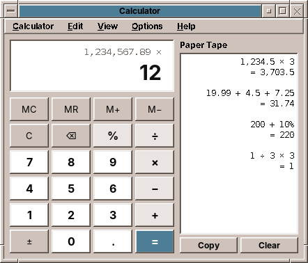
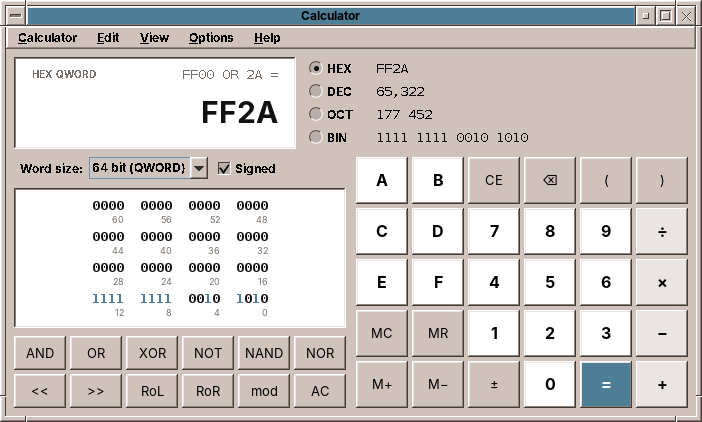

# amade-calculator

**amade-calculator** is the calculator of the [amadeOS](https://github.com/datazuul/amadeos) desktop: a desk calculator with a paper tape, a scientific calculator and a programmer's calculator in one window. Built like the other amadeOS applications.




## Features

- **Three modes**, switched in *View* (Ctrl+1, Ctrl+2, Ctrl+3) and remembered:
  - **Basic**: the four basic operations, percent, ±, memory (MC, MR, M+, M−).
  - **Scientific**: brackets, x², x³, xʸ, √x, ʸ√x, 1/x, n!, sin, cos, tan and their hyperbolic forms, with **2nd** for the inverse functions, ln, log, log₂, eˣ, 10ˣ, 2ˣ, |x|, π, e, EE (1.5 EE 3 is 1500), mod, a random number and Ans (the last result). Angles in degrees or radians (the DEG/RAD key).
  - **Programmer**: HEX, DEC, OCT and BIN at the same time (a click on one enters numbers in that base), word sizes of 8, 16, 32 and 64 bits, signed or unsigned, AND, OR, XOR, NOT, NAND, NOR, shifts and rotations, and a field of the 64 bits in which a click switches a bit. Results wrap around like in a CPU register.

  
  
- **Exact arithmetic**: numbers are decimal fractions with 34 digits (IEEE 754 decimal128), so 0.1 + 0.2 is 0.3 and 1 ÷ 3 × 3 is 1. The display shows 16 digits, very large and small numbers as 1.5e+20. Roots of non-squares, logarithms and the trigonometric functions are rounded to 15 digits, which makes sin(30°) exactly 0.5.
- **Precedence** as in mathematics: 2 + 3 × 4 is 14, 2 ^ 3 ^ 2 is 512. Open brackets count as closed at =.
- **Like a desk calculator**: functions apply at once to the number in the display, and the line above shows the whole calculation (`sin(30) + 2 × √(16)`). 200 + 10 % is 220, 100 × 19 % is 19. A second = repeats the last operation.
- **Paper tape** (*View → Paper Tape*, Ctrl+T): every calculation and its result, to copy as text or clear. It is kept while the program runs.
- **Keyboard**: digits (A–F in HEX), `.` or `,`, `+ - * / ^ % ( ) =`, Enter for =, Backspace, Delete for CE, Esc for C, `!` for n!, `p` for π, and in Programmer `& | ^ ~ < > %` for AND, OR, XOR, NOT, the shifts and mod. The pressed key lights up.
- **Copy and paste** (Ctrl+C, Ctrl+V): copies the number without grouping; pastes numbers as people write them (`1,234.5`, `1.234,5`, `1 234,5`, `0xFF`, `0b1010`).
- Digit grouping and the decimal separator follow the language; grouping can be switched off (*View → Digit Grouping*).
- Five languages (English, Deutsch, Français, Español, Italiano), following the amadeOS desktop language; *Options → Language* overrides it.
- Theme colours and Motif look from [amade-commons](https://github.com/datazuul/amade-commons).

## Architecture

Java 25, Swing and Guice; start-up, theme and language come from `AmadeApplication` in amade-commons.

| Package | Contents |
|---|---|
| `bootstrap` | `AmadeCalculatorApplication`, `CalculatorModule` |
| `domain` | `Calculator` (the expression being entered, the result, memory, errors), `Evaluator` (precedence and brackets), `NumberSystem` with `DecimalSystem` (BigDecimal, 34 digits) and `ProgrammerSystem` (integers of a word size), `Token`, `Term`, `ExpressionText`, `Operator`, `MathFunction`, `Mode`, `Settings`, `PastedNumber` |
| `repository` | `CalculatorPreferences` (`~/.config/amadeos/calculator/calculator.properties`) |
| `ui.main` | window, presenter, menus, `Key` and `Keypads`, `Display`, `BitField`, `PaperTape` |

The `Calculator` knows nothing of Swing: each key is one method, and the presenter maps keys and typed characters to them. Numbers are entered, computed and written by the current `NumberSystem`, so the same calculator works with decimal fractions and with programmer integers.

## Build and run

```sh
./gradlew run                              # start
./gradlew test                             # Swing tests need a display: xvfb-run ./gradlew test
./gradlew deb                              # build/distributions/amade-calculator_<version>_all.deb
./gradlew installToAmadeOs                 # the .deb into ../amadeos/config/packages.chroot/ for the ISO build
```

If `../amade-commons` is checked out next to this repository, Gradle builds against that checkout instead of the JitPack version.

## Planned

- A fourth mode **Convert** for units: length, area, volume, weight, temperature, speed, time, data sizes
- Currencies, with exchange rates from the internet
- Keeping the paper tape between starts, and printing it

## License

[EUPL-1.2](LICENSE)
